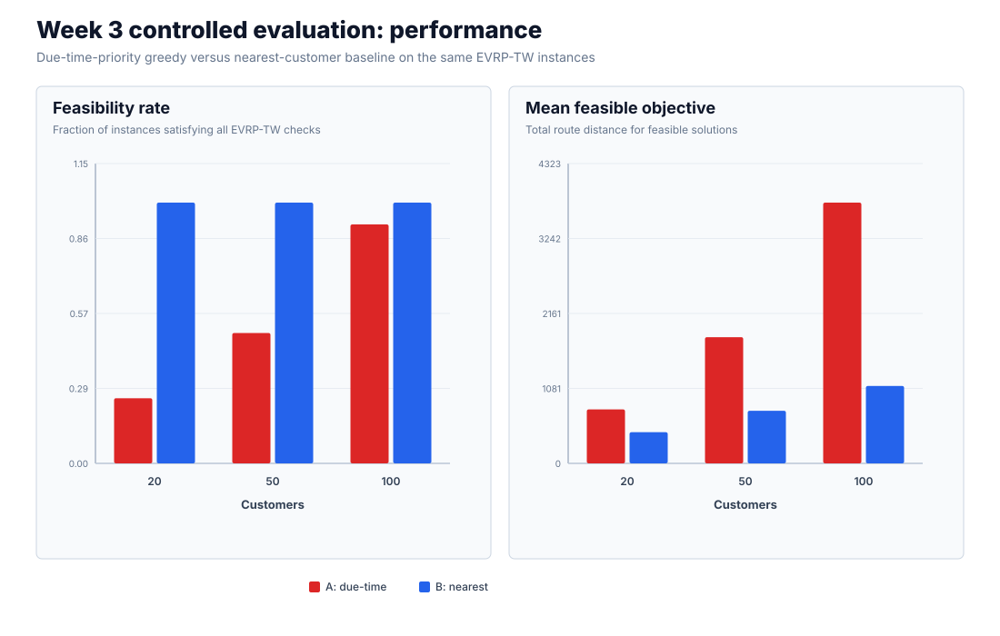
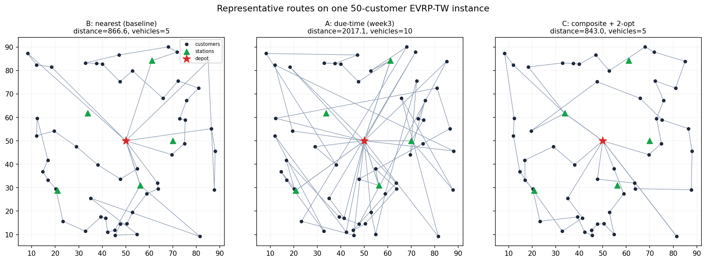
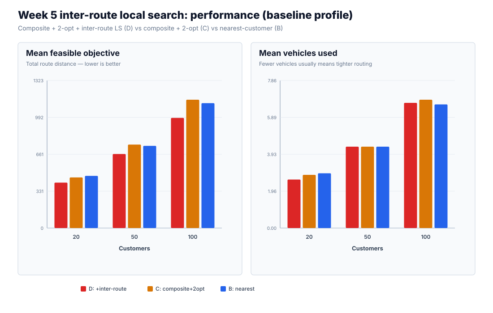
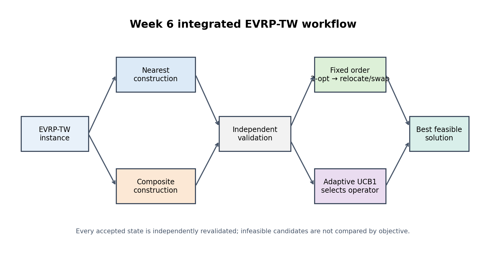
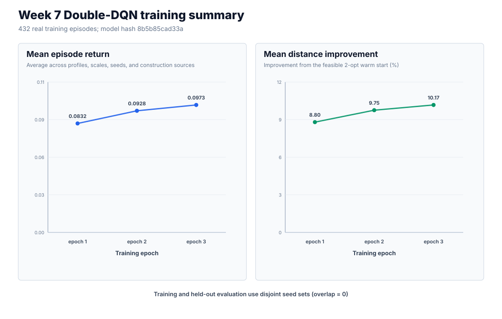
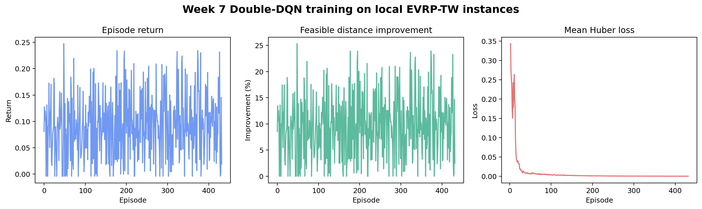
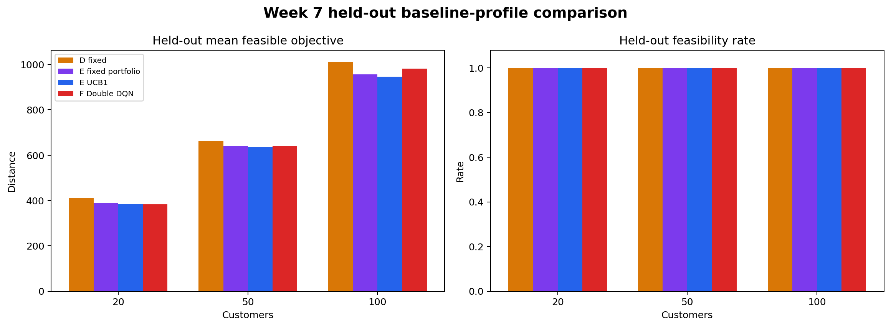
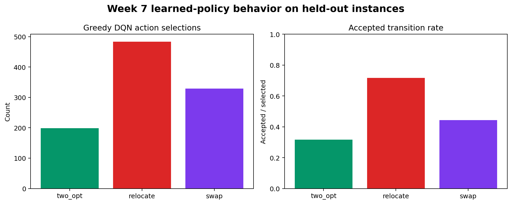
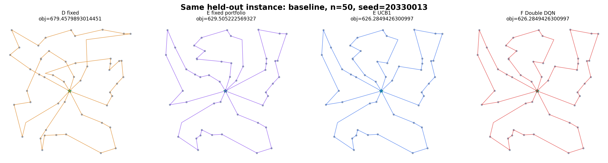

# Learning to Select Local-Search Operators for EVRP-TW

## A Reproducible Hybrid-Heuristic and Double-DQN Study

**Final Research Report**<br>
**Faculty Undergraduate Research Practice (FURP)**<br>
**Faculty of Science and Engineering, University of Nottingham Ningbo China**

| Field | Details |
|---|---|
| Student | Chenyu Fan |
| Student ID | 20810107 |
| Faculty | Faculty of Science and Engineering (FoSE) |
| Supervisor | Tianxiang Cui |
| Project | Deep Reinforcement Learning for Electric Vehicle Routing with Time Windows |
| Repository | [FURP-2026-Chenyu-Fan-Deep-RL-EVRP-TW](https://github.com/Rain-Fan/FURP-2026-Chenyu-Fan-Deep-RL-EVRP-TW) |
| Report date | 19 October 2026 |

---

## Abstract

The Electric Vehicle Routing Problem with Time Windows (EVRP-TW) requires a
fleet of battery-limited vehicles to serve all customers within specified time
windows while respecting vehicle capacity, battery, charging, fleet-size, and
depot-return constraints. This project investigates a deliberately focused
question: **can a compact learned policy improve EVRP-TW local search by
selecting when to apply 2-opt, relocate, and swap operators?** The final method
is a hybrid system rather than an end-to-end neural route constructor. It
combines deterministic route construction, feasibility-aware local search, an
independent EVRP-TW validator, and a seed-separated Double Deep Q-Network
(Double DQN) that controls the local-search operator sequence.

The research was developed through seven reproducible stages. Classical
OR-Tools examples established the routing constraint hierarchy. Controlled
EVRP-TW experiments then showed that a due-time-only greedy policy was less
feasible and much longer than a nearest-customer baseline. A composite scoring
rule restored feasibility, 2-opt reduced intra-route distance, and inter-route
relocate and swap moves closed the remaining medium-scale gap. A two-source
nearest/composite portfolio further improved solution quality, while a UCB1
selector reduced the cost of exhaustive search. Finally, a NumPy Double DQN
was trained on 432 episodes and evaluated on 54 unseen synthetic instances,
producing 216 held-out method runs with zero train-test seed overlap and zero
independent validation mismatches.

On the held-out set, Double DQN improved mean feasible distance over the Week 5
fixed single-source method in all nine profile-scale cells by 1.62% to 8.20%.
Against the stronger Week 6 UCB1 portfolio, it won five aggregate cells, tied
one, and lost three. Its largest failure was the baseline 100-customer cell,
where it was 3.65% longer than UCB1. All four final methods solved 53 of 54
instances; the shared failure occurred before operator selection because both
construction sources were infeasible. These results support learned
state-dependent operator selection as a useful component, but do not support a
claim of universal superiority or state-of-the-art EVRP-TW performance. The
main next steps are construction repair, route-aware state representations, and
evaluation on Schneider benchmark instances.

**Keywords:** EVRP-TW, electric vehicle routing, time windows, local search,
operator selection, Double DQN, reinforcement learning, reproducibility

---

## Table of Contents

1. [Introduction](#1-introduction)
2. [Research Questions and Contributions](#2-research-questions-and-contributions)
3. [Background and Related Work](#3-background-and-related-work)
4. [Problem Definition](#4-problem-definition)
5. [Research Methodology](#5-research-methodology)
6. [Experimental Design](#6-experimental-design)
7. [Results](#7-results)
8. [Discussion](#8-discussion)
9. [Failure Analysis and Limitations](#9-failure-analysis-and-limitations)
10. [Reproducibility and Research Integrity](#10-reproducibility-and-research-integrity)
11. [Conclusion and Future Work](#11-conclusion-and-future-work)
12. [References](#12-references)
13. [Appendices](#13-appendices)

---

## 1. Introduction

### 1.1 Motivation

Vehicle routing is a core combinatorial-optimisation problem in logistics. The
standard Vehicle Routing Problem (VRP) asks how a fleet should serve a set of
customers at minimum cost. EVRP-TW is harder because routing decisions interact
with several resources:

- each customer must be served exactly once;
- every vehicle has limited carrying capacity;
- service must start within each customer's time window;
- travel consumes battery energy;
- vehicles may need to visit charging stations;
- charging consumes time and changes later time-window feasibility;
- every used route must start and finish at the depot; and
- the fleet contains only a limited number of vehicles.

A route that is short in Euclidean distance may therefore be invalid. A method
must distinguish objective quality from feasibility and must not treat an
infeasible short route as an improvement.

Deep reinforcement learning has produced strong constructive policies for TSP
and CVRP, especially through attention models and multi-start training [2],
[3]. Directly transferring those methods to EVRP-TW is difficult because the
decoder must represent time, load, battery, repeated station visits, and depot
return. This project adopts a narrower and more auditable use of reinforcement
learning: classical procedures construct feasible routes, and RL selects among
existing deterministic improvement operators.

### 1.2 Project objective

The project objective is to build and evaluate a reproducible hybrid EVRP-TW
solver in which learning controls local search without controlling the complete
route-construction process. The resulting system must:

1. retain feasible solutions throughout local improvement;
2. compare learned selection with transparent fixed and adaptive baselines;
3. use held-out instances with disjoint random seeds;
4. preserve negative and inconclusive results; and
5. provide code, raw tables, figures, checkpoints, logs, and reproducibility
   checks in one public repository.

### 1.3 Scope and claim boundary

The final implementation is a **Double-DQN operator-selection prototype**. It
is not an attention-based end-to-end route constructor and is not claimed to be
state of the art. Its compact 12-value state summarises the search process but
does not encode the complete customer or route graph. Evaluation uses
controlled synthetic instances generated by the repository, not the public
Schneider benchmark set. The results therefore establish internal comparative
evidence and reproducibility, not external benchmark superiority.

---

## 2. Research Questions and Contributions

### 2.1 Primary research question

> Can a compact, seed-separated Double DQN learn to select 2-opt, relocate, and
> swap operators more effectively than a fixed schedule or UCB1 on held-out
> EVRP-TW instances, while preserving independently verified feasibility?

### 2.2 Supporting questions

1. Why does a due-time-only greedy construction policy fail relative to a
   nearest-customer policy?
2. Can a composite distance/urgency/slack score recover feasibility without
   losing route quality?
3. How much do intra-route 2-opt and inter-route relocate/swap contribute?
4. Does a portfolio of nearest and composite construction sources outperform a
   single construction source?
5. Can bounded adaptive selection reduce the runtime of exhaustive portfolio
   search while retaining most of its quality?
6. Does a learned state-dependent selector generalise beyond its training
   seeds and profiles?

### 2.3 Contributions

The project makes the following scoped contributions:

- **A controlled EVRP-TW experimental pipeline.** All compared methods share
  the same instances, feasibility rules, objective, stopping criteria, and
  result schema within each experiment.
- **A transparent progression from failure to improvement.** The method design
  is motivated by measured weaknesses rather than introduced as an isolated
  algorithm.
- **A feasibility-preserving hybrid solver.** Two construction rules, 2-opt,
  relocate, swap, candidate selection, and an independent validator are
  combined into one auditable workflow.
- **A reproducible operator-selection MDP.** Real route operators define the
  actions; accepted states must be shorter and independently feasible.
- **A dependency-light Double DQN.** The learner is implemented in NumPy with
  replay, online and target networks, Double-DQN targets, Huber loss, Adam,
  gradient clipping, and validated checkpoints.
- **Honest held-out evidence.** Training and evaluation seeds are disjoint;
  DQN wins and losses against UCB1 are both reported.
- **A full evidence trail.** Generated JSON, CSV, Markdown, figures, run logs,
  tests, route records, action traces, and model manifests are committed.

---

## 3. Background and Related Work

### 3.1 Classical routing foundations

The project begins from a constraint hierarchy:

| Problem | Additional structure | Central feasibility requirement |
|---|---|---|
| TSP | Single closed tour | Visit every node once and return |
| VRP | Multiple vehicles | Partition customers among depot-anchored routes |
| CVRP | Vehicle load | Route demand cannot exceed capacity |
| VRPTW | Service intervals | Service must begin inside every time window |
| EVRP-TW | Battery and charging | Energy and charging decisions must remain feasible |

Week 1 reproduced Google OR-Tools demonstrations for TSP, VRP, CVRP, and
VRPTW. This established an important reporting rule used throughout the
project: feasibility, route cost, fleet use, and runtime must be reported
separately.

### 3.2 EVRP-TW formulation and benchmarks

Schneider, Stenger, and Goeke formalised an electric VRP with time windows and
recharging stations [1]. Their formulation combines customer coverage,
capacity, time, and battery constraints, and uses station copies to represent
repeated station visits. Their VNS/Tabu Search method also demonstrates that
EVRP-TW benefits from specialised improvement and station-insertion
operators. The present project adopts the same broad constraint categories,
but simplifies the charging model to deterministic full recharge with fixed
charging time and uses synthetic Euclidean instances.

### 3.3 Attention models for routing

Kool, van Hoof, and Welling showed that an attention-based encoder-decoder can
learn constructive policies for routing problems [2]. Feasibility masks remove
invalid actions, while REINFORCE with a rollout baseline trains the decoder to
minimise route length. This work motivates learned routing decisions, but its
standard TSP/CVRP formulation does not directly include EVRP-TW battery,
charging, or time-window dynamics.

### 3.4 Deep RL for EVRP-TW

Lin, Ghaddar, and Nathwani applied deep reinforcement learning directly to
EVRP-TW [4]. Their work is the closest published match to the repository's
title and demonstrates how graph representation, sequential decisions, and
constraint-aware decoding can address electric routing. Reproducing that full
architecture was outside the scale of this project. Instead, the present work
implements a smaller but complete learning loop around local-search control.

### 3.5 POMO and multiple solution candidates

POMO exploits multiple equivalent or useful starting points and a shared
baseline to improve neural combinatorial optimisation [3]. Week 2 recreated
the relevant multi-start inference idea as a **POMO-style heuristic**, not as a
trained POMO network. Later, the project carries the same high-level insight
into a nearest/composite portfolio: generate more than one valid starting
solution and retain the best feasible result after improvement.

### 3.6 Position of this project

The final approach is best described as **hybrid learning-guided local search**:

```text
deterministic feasible construction
    -> classical local-search operators
    -> independent constraint validation
    -> learned operator selection
```

This positioning provides stronger interpretability and a lower implementation
risk than end-to-end neural construction. It also exposes a clear limitation:
the learned policy can improve only the feasible candidate supplied to it; it
cannot repair a failed construction stage.

---

## 4. Problem Definition

### 4.1 Sets and data

Let the directed graph be (G=(V,A)), where:

- (0) is the depot;
- (C) is the set of customers;
- (S) is the set of charging stations; and
- (V=\{0\}\cup C\cup S).

Every node has two-dimensional coordinates. For each customer (i\in C), the
instance specifies demand (q_i), ready time (e_i), due time (l_i), and
service time (s_i). The Euclidean distance between nodes (i) and (j) is
(d_{ij}). Vehicles are homogeneous and have load capacity (Q), battery
capacity (B), travel speed (v), energy rate (\rho), and fixed charging
time (g). At most (K) vehicle routes may be used.

### 4.2 Objective

The implemented objective is total Euclidean route distance:

$$
\min L(R)=\sum_{r\in R}\sum_{(i,j)\in r}d_{ij}.
$$

Distance is compared only between feasible solutions. An infeasible route set
has no valid objective in the aggregate result tables.

### 4.3 Feasibility conditions

A route set is feasible only if all of the following hold.

**Coverage.** Every customer appears exactly once:

$$
\sum_{r\in R}\sum_{p}\mathbf{1}[r_p=i]=1,\qquad \forall i\in C.
$$

**Depot anchoring.** Every route starts and ends at node 0.

**Fleet.** The number of used routes does not exceed (K).

**Capacity.** The total demand of customers on each route is at most (Q):

$$
\sum_{i\in r\cap C}q_i\leq Q.
$$

**Time windows.** If a vehicle reaches customer (j) at time (a_j), service
starts at (t_j=\max(a_j,e_j)) and must satisfy (t_j\leq l_j). Travel,
waiting, service, and charging time propagate to later nodes.

**Battery.** Each leg consumes (\rho d_{ij}). Remaining energy may not become
negative. A visit to a charging station or depot resets the battery to (B).

**Charging.** Stations may be revisited and are not treated as customers.
Every station visit adds the fixed charging duration (g).

### 4.4 Implemented synthetic instance model

The shared generator used from Week 3 onward has the following baseline
settings:

| Parameter | Value |
|---|---:|
| Customer scales | 20, 50, 100 |
| Coordinate range | Uniform in ([8,92]\times[8,92]) |
| Depot | ((50,50)) |
| Customer demand | Integer from 1 to 5 |
| Customer service time | 4.0 |
| Vehicle capacity | 55 |
| Battery capacity | 185.0 |
| Energy rate | 1.0 per distance unit |
| Speed | 1.0 distance unit per time unit |
| Charging time | 18.0 per station visit |
| Charging stations | (\max(5,\lceil n/14\rceil)) |
| Maximum vehicles | (\max(4,\lceil n/5\rceil)) |

Customer time windows are generated with broad widths linked to depot
distance, reducing trivial infeasibility. Charging stations are arranged around
the depot. Three profiles are used:

| Profile | Time-window scale | Battery scale | Purpose |
|---|---:|---:|---|
| `baseline` | 1.00 | 1.00 | Reference setting |
| `tight_tw` | 0.60 | 1.00 | Stress temporal feasibility |
| `small_battery` | 1.00 | 0.75 | Stress energy and charging feasibility |

The coordinates, demands, and random seeds remain fixed across profiles, so the
profile comparison changes only the intended constraint pressure.

---

## 5. Research Methodology

### 5.1 Overview of the seven-stage progression

| Stage | Method or activity | Purpose | Main evidence |
|---|---|---|---|
| Week 1 | OR-Tools TSP/VRP/CVRP/VRPTW | Establish routing foundations | Four feasible demonstrations |
| Week 2 | POMO-style, GA, OR-Tools EVRP-TW baselines | Compare method families | 50/100/200-customer runs |
| Week 3 | A due-time vs B nearest | Controlled baseline experiment | Due-time rule fails on feasibility and distance |
| Week 4 | C composite + 2-opt | Repair Week 3 weakness | 324 runs over profiles and scales |
| Week 5 | D composite + inter-route search | Close medium-scale gap | 106/108 feasible; shortest routes so far |
| Week 6 | E fixed and E adaptive portfolio | Combine constructors; test UCB1 | 432 runs and 2,364 action traces |
| Week 7 | F Double-DQN portfolio | Learn state-dependent selection | 432 training episodes; 216 held-out runs |

### 5.2 Week 1: classical routing baselines

The initial implementation reproduced 17-node OR-Tools examples using the
`PATH_CHEAPEST_ARC` first-solution strategy. The four methods all returned
feasible solutions. Their objectives are not directly comparable because they
represent different problems, but they validated the development environment
and illustrated the constraint hierarchy.

| Problem | Solver objective | Additional evidence | Vehicles |
|---|---:|---|---:|
| TSP | 4,384 | Total distance 4,384 m | 1 |
| VRP | 177,500 | Distance 6,300 m; max route 1,712 m | 4 |
| CVRP | 6,872 | Capacity 15 per route | 4 |
| VRPTW | 74 | Total travel time 74 | 4 |

### 5.3 Week 2: method-family comparison

Week 2 introduced explicit EVRP-TW feasibility checks and compared:

- a POMO-style multi-start masked greedy heuristic;
- a genetic algorithm over customer permutations with deterministic repair;
- OR-Tools CVRPTW followed by charging repair.

This experiment did not reproduce the full trained POMO architecture. It
isolated the multi-start construction idea. OR-Tools produced the shortest
route at each scale but used an eight-second search limit, while the POMO-style
heuristic was much faster. The GA repair remained feasible but produced much
longer routes.

| Customers | POMO-style objective / s | GA objective / s | OR-Tools objective / s |
|---:|---:|---:|---:|
| 50 | 669.88 / 0.013 | 1,670.61 / 0.306 | 536.84 / 8.003 |
| 100 | 1,159.84 / 0.062 | 4,942.38 / 1.269 | 1,012.07 / 8.004 |
| 200 | 2,090.49 / 0.290 | 9,602.82 / 2.839 | 1,665.01 / 8.005 |

All nine results were feasible under the implemented capacity, time-window,
battery, charging, coverage, and depot-return checks.

### 5.4 Week 3: controlled greedy-policy experiment

Method A selects the feasible customer with the earliest due time. Baseline B
selects the nearest feasible customer. Both receive the same candidate set and
use the same constraints and stopping conditions.

The negative result was decisive. A due-time-only priority produced spatially
scattered routes, exhausted the vehicle limit, and left customers unserved.
Nearest-customer construction was feasible on every instance.

| Customers | A feasibility | B feasibility | A mean feasible distance | B distance | Difference A-B |
|---:|---:|---:|---:|---:|---:|
| 20 | 3/12 | 12/12 | 777.501 | 449.799 | +327.701 |
| 50 | 6/12 | 12/12 | 1,819.997 | 758.561 | +1,061.437 |
| 100 | 11/12 | 12/12 | 3,759.097 | 1,116.221 | +2,642.877 |

The failures were coverage failures rather than hidden time, capacity, or
battery violations. This diagnosis directly motivated Method C.



### 5.5 Week 4: composite construction and 2-opt

Method C ranks feasible customer candidates using the fixed score

$$
\text{score}=1.00\,\hat d+0.35\,\hat u+0.25\,\hat s,
$$

where (\hat d) is normalised travel distance, (\hat u) is normalised due-time
urgency, and (\hat s) is normalised remaining slack. Lower scores are
preferred. Distance receives the largest weight to prevent the spatial
scattering observed in Week 3.

After construction, feasibility-aware 2-opt reverses customer subsequences and
accepts a move only if the route remains feasible and becomes strictly shorter.
Across 324 controlled method-instance runs, C was feasible on 107/108 cases,
compared with 45/108 for A and 108/108 for B. Mean 2-opt gain increased with
scale:

| Profile | n=20 | n=50 | n=100 |
|---|---:|---:|---:|
| Baseline | 15.7 | 36.5 | 87.3 |
| Tight time windows | 23.0 | 44.3 | 101.6 |
| Small battery | 8.7 | 25.5 | 63.8 |

Method C recovered feasibility and was competitive with B, but still trailed B
in some cells, especially baseline n=50. That residual weakness motivated
inter-route moves.



### 5.6 Week 5: inter-route local search

Method D adds two feasibility-aware neighbourhoods after Method C:

- **relocate (or-opt-1):** remove one customer from a donor route and insert it
  at the best feasible position in another route;
- **swap:** exchange one customer between two routes.

Relocate and swap alternate for at most ten rounds. A move is accepted only if
both affected routes remain feasible and their combined distance strictly
decreases.

Method D reduced mean distance against C in all nine profile-scale cells by
6.63% to 15.74%. Against nearest baseline B, it was shorter by 9.31% to 15.18%
on jointly feasible cases. In particular, the baseline n=50 gap changed from C
being 1.6% worse than B to D being 9.89% better.



### 5.7 Week 6: portfolio search and UCB1

Week 6 combines nearest and composite construction sources. Each feasible
candidate receives a 2-opt warm start. Two selectors are compared:

- **E-fixed:** apply the full fixed improvement schedule to both candidates;
- **E-adaptive:** use deterministic UCB1 to select from 2-opt, relocate, and
  swap, stopping after 12 actions or four consecutive non-improvements.

The UCB1 score combines each action's observed mean normalised reward with an
exploration bonus. Every accepted state passes the independent validator.



E-adaptive improved mean feasible distance over D in all nine cells by 3.30%
to 7.29%. E-fixed recorded no per-instance losses against D, demonstrating that
the two-source portfolio is the main quality contribution. At n=100,
E-adaptive used approximately 62% to 67% of E-fixed runtime, while accepting a
small quality gap in several cells.

The 2,364 action traces showed that operator effectiveness was unequal:

| Operator | Selected | Accepted | Mean normalised reward |
|---|---:|---:|---:|
| 2-opt | 781 | 234 | 0.0022 |
| Relocate | 809 | 712 | 0.0214 |
| Swap | 774 | 407 | 0.0067 |

This evidence justified a state-dependent learner while also establishing a
strong non-learning UCB1 baseline.

### 5.8 Week 7: Double-DQN operator selection

#### 5.8.1 MDP

An episode begins from a feasible nearest or composite candidate after 2-opt.
The state contains 12 values:

1. customer scale divided by 100;
2. used-route ratio;
3. current/warm-start objective ratio;
4. cumulative improvement ratio;
5. search progress;
6. stagnation ratio;
7. clipped previous reward;
8. accepted-step ratio;
9-11. one-hot representation of the previous action; and
12. construction-source indicator.

The three actions are 2-opt, relocate, and swap. For a transition from current
distance (L_t) and warm-start distance (L_0):

$$
r_t=
\begin{cases}
(L_t-L_{t+1})/L_0, & \text{feasible strict improvement},\\
-0.001, & \text{feasible non-improvement},\\
-1, & \text{infeasible proposal}.
\end{cases}
$$

Infeasible and non-improving proposals are rejected. An episode terminates at
12 actions or after four consecutive non-improvements.

#### 5.8.2 Network and learning algorithm

The Q-network is a 12-32-3 multilayer perceptron with a ReLU hidden layer.
Training uses:

| Hyperparameter | Value |
|---|---:|
| Hidden units | 32 |
| Replay capacity | 5,000 |
| Batch size | 32 |
| Learning rate | 0.001 |
| Discount factor | 0.95 |
| Target sync interval | 100 updates |
| Gradient clipping norm | 5.0 |
| Epsilon schedule | 1.00 to 0.05 |
| Training epochs | 3 |
| Maximum episode steps | 12 |
| Patience | 4 |

The online network selects the next action, while the target network evaluates
that action in the bootstrap target:

$$
y=r+\gamma(1-d)Q_{\text{target}}
\left(s',\arg\max_a Q_{\text{online}}(s',a)\right).
$$

The implementation uses Huber loss, Adam, experience replay, periodic target
synchronisation, and checkpoint validation. The model is intentionally small
so its behaviour and limitations remain inspectable.



---

## 6. Experimental Design

### 6.1 Final experiment matrix

The final evaluation covers:

- three profiles: baseline, tight time windows, and small battery;
- three scales: 20, 50, and 100 customers;
- eight training seeds per profile-scale cell;
- six held-out seeds per profile-scale cell;
- two construction sources per training instance;
- three training epochs; and
- four held-out methods per instance.

This produces 432 training episodes and 216 held-out method runs on 54 unseen
instances.

### 6.2 Seed separation

Training seeds use base seed `20270013`; evaluation seeds use base seed
`20280013`. Scale-specific offsets produce 24 unique training seed identifiers
and 18 unique evaluation identifiers, reused consistently across the three
profiles. Their intersection is empty. Splitting by instance seed prevents
transitions from one instance from appearing in both training and evaluation.

### 6.3 Compared methods

| ID | Method | Construction | Search control |
|---|---|---|---|
| D | Composite inter-route | Composite only | Fixed Week 5 schedule |
| E-fixed | Fixed portfolio | Nearest + composite | Exhaustive fixed search |
| E-adaptive | UCB1 portfolio | Nearest + composite | Deterministic UCB1 |
| F-DQN | Learned portfolio | Nearest + composite | Greedy Double DQN at test time |

All four methods receive the same held-out instances. Portfolio methods share
the same construction sources, 2-opt warm start, operator implementations, and
validator. E-adaptive and F-DQN additionally share the same 12-step budget and
four-failure patience rule, so the selector is the main changing component in
their direct comparison. E-fixed instead applies the complete fixed schedule
and serves as an exhaustive-search ablation.

### 6.4 Evaluation metrics

| Metric | Interpretation |
|---|---|
| Feasibility rate | Fraction of attempted instances passing all checks |
| Mean feasible objective | Mean total distance over feasible solutions only |
| Median and best objective | Distribution summaries over feasible solutions |
| Runtime | Mean wall-clock solve time over all attempts |
| Vehicles used | Number of non-empty depot-anchored routes |
| Constraint violations | Coverage, depot, capacity, time-window, and battery errors |
| Accepted moves | Number of accepted local-search moves |
| Win/tie/loss | Paired instance comparison on jointly feasible cases |
| Action frequency | How often DQN selects each operator |
| Acceptance rate | Fraction of selections producing strict feasible improvement |
| Training return | Sum of transition rewards per episode |
| Warm-start improvement | Percentage distance removed during an episode |

### 6.5 Environment

The final Week 7 run records:

| Component | Recorded value |
|---|---|
| Operating system | macOS 15.6, arm64 |
| Processor family | Apple Silicon; Week 1 log records Apple M4 |
| Python | 3.14.0 for the final run |
| NumPy | 2.5.0 |
| Matplotlib | 3.10.9 in project requirements |
| OR-Tools | 9.15.6755 in project requirements |
| Training runtime | 92.54 seconds |
| Complete train/evaluate runtime | 206.59 seconds |

Wall-clock runtime depends on machine load and is not included in deterministic
signatures.

### 6.6 Fairness controls

- Objective values are averaged only over feasible routes.
- Feasibility and runtime include every attempted method-instance run.
- Accepted moves must strictly reduce distance.
- Every reported final route is checked by the independent validator.
- Training and evaluation seeds are disjoint.
- DQN evaluation uses greedy action selection (`epsilon = 0`).
- Failed instances and losing DQN comparisons remain in the report.
- UCB1 and DQN share operators and stopping budgets; E-fixed uses the complete
  fixed schedule as an exhaustive-search reference.

---

## 7. Results

### 7.1 Training evidence

Training generated 4,388 transitions and 4,357 optimiser updates. Mean return
and mean warm-start improvement increased over the three epochs:

| Epoch | Episodes | Mean return | Mean warm-start improvement | Mean steps | Mean accepted steps |
|---:|---:|---:|---:|---:|---:|
| 1 | 144 | 0.0832 | 8.80% | 10.03 | 5.17 |
| 2 | 144 | 0.0928 | 9.75% | 10.37 | 5.67 |
| 3 | 144 | 0.0973 | 10.17% | 10.07 | 5.63 |

This trend shows that the network learned a more useful selection policy on the
training distribution. It does not by itself establish generalisation; the
held-out comparison provides that test.



### 7.2 Held-out aggregate results

The following table reports the complete final aggregate matrix. Objective
values are mean feasible distances. Runtime is mean seconds over all attempted
runs.

| Profile | n | Method | Feasible | Mean objective | Runtime (s) |
|---|---:|---|---:|---:|---:|
| Baseline | 20 | D fixed single-source | 6/6 | 411.080 | 0.0049 |
| Baseline | 20 | E fixed portfolio | 6/6 | 387.740 | 0.0101 |
| Baseline | 20 | E UCB1 portfolio | 6/6 | 385.435 | 0.0142 |
| Baseline | 20 | F Double DQN | 6/6 | **383.334** | 0.0141 |
| Baseline | 50 | D fixed single-source | 6/6 | 663.486 | 0.1054 |
| Baseline | 50 | E fixed portfolio | 6/6 | 639.872 | 0.2015 |
| Baseline | 50 | E UCB1 portfolio | 6/6 | **635.018** | 0.1903 |
| Baseline | 50 | F Double DQN | 6/6 | 639.444 | 0.2040 |
| Baseline | 100 | D fixed single-source | 6/6 | 1,012.983 | 0.9889 |
| Baseline | 100 | E fixed portfolio | 6/6 | 956.543 | 1.8606 |
| Baseline | 100 | E UCB1 portfolio | 6/6 | **946.415** | 1.3086 |
| Baseline | 100 | F Double DQN | 6/6 | 980.947 | 1.1657 |
| Tight TW | 20 | D fixed single-source | 6/6 | 429.989 | 0.0066 |
| Tight TW | 20 | E fixed portfolio | 6/6 | 402.439 | 0.0124 |
| Tight TW | 20 | E UCB1 portfolio | 6/6 | 400.009 | 0.0155 |
| Tight TW | 20 | F Double DQN | 6/6 | **399.180** | 0.0158 |
| Tight TW | 50 | D fixed single-source | 6/6 | 722.108 | 0.1287 |
| Tight TW | 50 | E fixed portfolio | 6/6 | 667.674 | 0.2298 |
| Tight TW | 50 | E UCB1 portfolio | 6/6 | 669.651 | 0.1930 |
| Tight TW | 50 | F Double DQN | 6/6 | **662.886** | 0.2255 |
| Tight TW | 100 | D fixed single-source | 6/6 | 1,017.905 | 1.1082 |
| Tight TW | 100 | E fixed portfolio | 6/6 | 967.338 | 1.8058 |
| Tight TW | 100 | E UCB1 portfolio | 6/6 | 967.205 | 1.2057 |
| Tight TW | 100 | F Double DQN | 6/6 | **965.685** | 1.2976 |
| Small battery | 20 | D fixed single-source | 5/6 | 442.673 | 0.0050 |
| Small battery | 20 | E fixed portfolio | 5/6 | **435.503** | 0.0098 |
| Small battery | 20 | E UCB1 portfolio | 5/6 | **435.503** | 0.0112 |
| Small battery | 20 | F Double DQN | 5/6 | **435.503** | 0.0139 |
| Small battery | 50 | D fixed single-source | 6/6 | 732.680 | 0.1005 |
| Small battery | 50 | E fixed portfolio | 6/6 | 708.009 | 0.1997 |
| Small battery | 50 | E UCB1 portfolio | 6/6 | **705.530** | 0.1664 |
| Small battery | 50 | F Double DQN | 6/6 | 708.534 | 0.1993 |
| Small battery | 100 | D fixed single-source | 6/6 | 1,052.850 | 1.0114 |
| Small battery | 100 | E fixed portfolio | 6/6 | 1,017.379 | 2.0977 |
| Small battery | 100 | E UCB1 portfolio | 6/6 | 1,028.200 | 1.2663 |
| Small battery | 100 | F Double DQN | 6/6 | **1,018.437** | 1.3167 |



### 7.3 Double DQN against Method D

Double DQN was shorter than the Week 5 single-source fixed method in all nine
aggregate cells, with no feasibility-rate change.

| Profile | n=20 | n=50 | n=100 |
|---|---:|---:|---:|
| Baseline | -6.75% | -3.62% | -3.16% |
| Tight time windows | -7.16% | -8.20% | -5.13% |
| Small battery | -1.62% | -3.30% | -3.27% |

This result establishes that the portfolio plus learned search is stronger than
the earlier fixed single-source workflow on the held-out set. It does not
isolate learning alone because D differs in both construction portfolio and
selector.

### 7.4 Double DQN against UCB1

The comparison against E-adaptive isolates the selector more closely because
both methods use the same construction sources and operators.

| Profile | n | DQN-UCB1 objective delta | Runtime delta (s) | Paired W/T/L |
|---|---:|---:|---:|---:|
| Baseline | 20 | **-0.55%** | -0.000 | 2/3/1 |
| Baseline | 50 | +0.70% | +0.014 | 1/3/2 |
| Baseline | 100 | +3.65% | -0.143 | 0/0/6 |
| Tight TW | 20 | **-0.21%** | +0.000 | 2/3/1 |
| Tight TW | 50 | **-1.01%** | +0.032 | 2/4/0 |
| Tight TW | 100 | **-0.16%** | +0.092 | 3/0/3 |
| Small battery | 20 | 0.00% | +0.003 | 0/5/0 |
| Small battery | 50 | +0.43% | +0.033 | 1/4/1 |
| Small battery | 100 | **-0.95%** | +0.050 | 4/1/1 |

Negative objective delta means DQN is shorter. DQN wins five aggregate cells,
ties one, and loses three. The result is profile- and scale-dependent rather
than universally positive.

### 7.5 Learned action behaviour

The held-out DQN trace contains 1,012 action decisions:

| Action | Selected | Accepted | Acceptance rate |
|---|---:|---:|---:|
| 2-opt | 199 | 63 | 31.7% |
| Relocate | 484 | 347 | 71.7% |
| Swap | 329 | 146 | 44.4% |

The policy strongly favours relocate, consistent with the Week 6 trace in which
relocate achieved the largest mean reward. However, the policy still selects
all three actions and varies its decisions across states.



### 7.6 Feasibility and violations

All four final methods solve 53 of 54 held-out instances. The only shared
failure is `small_battery`, n=20, seed `20300014`. Method D and the portfolio
constructors leave customers 8 and 18 unserved. F-DQN reports an infeasible
construction or warm start and therefore never begins an RL episode. Across all
feasible final outputs, the independent validator reports:

- zero duplicate-customer failures;
- zero unserved-customer failures;
- zero depot-anchor failures;
- zero capacity, time-window, or battery failures; and
- zero mismatches between method output and independent validation.

### 7.7 Representative route evidence

The representative held-out n=50 figure shows that all portfolio methods reduce
the same initial D route from 679.5 to 626.3 distance units, but reach that
objective through different operator sequences. This illustrates why action
selection is sequential: different move orders can reach the same or different
local optima.



---

## 8. Discussion

### 8.1 What produced the largest improvement?

The strongest evidence indicates that **portfolio construction and classical
local search**, rather than learning alone, produced the largest reliable
quality gains.

1. Week 3 showed that a poor construction priority can destroy feasibility.
2. Composite construction restored feasible compact routes.
3. 2-opt removed intra-route crossings, with larger gains at larger scales.
4. Relocate and swap closed the remaining medium-scale gap and produced 6.63%
   to 15.74% gains over Method C.
5. The nearest/composite portfolio improved over Method D in every Week 6 cell.
6. Double DQN then made smaller, mixed improvements relative to UCB1.

This ordering is scientifically important. The final result should not be
interpreted as "DQN solved EVRP-TW." DQN selected operators inside a strong
validated heuristic framework.

### 8.2 Why did the composite score work?

The due-time-only rule ignored spatial coherence. It could serve urgent
customers in a geographically scattered order, open too many routes, and
exhaust the fleet before covering all customers. The composite score made
distance dominant and used urgency/slack as secondary information. This
preserved compactness while still recognising temporal pressure. Its 99.1%
overall Week 4 feasibility demonstrates that the failure mechanism was
correctly identified.

### 8.3 Why did inter-route search matter?

2-opt changes order within one route but cannot transfer a customer between
vehicles. If construction assigns customers to inefficient routes, only an
inter-route move can repair that allocation. Relocate can also empty a route,
reducing vehicle use, while swap can remove crossings across route boundaries.
The large Week 5 gains, especially at n=100, are consistent with the greater
number of possible cross-route corrections in larger instances.

### 8.4 Portfolio value versus selector value

E-fixed had no paired losses against D in Week 6, showing that evaluating both
nearest and composite sources is robust. E-adaptive sometimes lost because a
12-action budget and exploration do not reproduce exhaustive fixed search.
Its advantage is computational: at n=100 it preserved most of the portfolio
quality at substantially lower runtime.

The DQN/UCB1 comparison is smaller and mixed. DQN's wins in all three tight-TW
cells suggest that state context can help under temporal pressure. Its failure
at baseline n=100 shows that the compact state is not sufficient for every
search landscape.

### 8.5 Why did Double DQN fail at baseline n=100?

In the baseline n=100 cell, DQN was 3.65% longer than UCB1 and lost all six
paired instances. Seed `20380016` was 85.36 distance units worse than UCB1.
The most plausible explanation is partial observability: the 12-value state
summarises global progress but does not represent route geometry, customer
positions, route-specific slack, or the distribution of candidate move gains.
Two states with similar aggregate values may require different operators. The
network therefore learns a coarse operator preference - especially for
relocate - without seeing enough information to select precisely on large
routes.

### 8.6 Runtime trade-off

Runtime grows rapidly with scale because relocate and swap enumerate many
cross-route candidates. Method D already increases from approximately 0.005 s
at n=20 to around 1.0 s at n=100 in the final held-out experiment. Portfolio
methods may evaluate two candidates, further increasing cost. DQN does not
remove the cost of an operator pass; it only changes which pass is executed.
It is faster than UCB1 at baseline n=100 because it chooses a different sequence,
but is slower in most tight-TW and small-battery cells. A learned selector
therefore offers a quality/runtime policy, not a guaranteed speed-up.

### 8.7 Answer to the primary question

The evidence gives a qualified answer. A compact Double DQN can learn useful
operator preferences and can outperform UCB1 in some held-out profile-scale
cells while preserving feasibility. It does not consistently outperform UCB1,
and its large-scale baseline generalisation is weak. The correct conclusion is
that state-dependent learning is promising but the current state representation
and data distribution are insufficient for universal superiority.

---

## 9. Failure Analysis and Limitations

### 9.1 Construction-stage infeasibility

The shared small-battery n=20 failure occurs before local search. Both nearest
and composite construction fail to produce a feasible warm start, so fixed,
UCB1, and DQN selectors have no valid state to improve. This is an architectural
boundary, not a poor action choice. The appropriate remedy is a construction
repair or station-insertion action.

### 9.2 Synthetic-only evaluation

Training and held-out seeds are disjoint, but both sets come from the same
generator. This measures interpolation to unseen random instances, not transfer
to the Schneider benchmark distribution or real road networks. Published
performance claims require standard benchmark instances and comparable
objective conventions.

### 9.3 Simplified charging model

The implementation uses Euclidean distance, linear distance-based energy
consumption, fixed charging duration, and full recharge at every station. It
does not model nonlinear charging curves, partial charging, traffic, gradient,
payload-dependent consumption, station queues, or limited charger capacity.

### 9.4 Limited RL state

The 12-value state does not include node embeddings, route embeddings, explicit
time-window distributions, battery profiles per route, or candidate-operator
features. It is inexpensive and interpretable, but can alias structurally
different route sets.

### 9.5 Small training set and short schedule

The learner receives 432 episodes and only three epochs. This is sufficient for
a complete prototype but much smaller than modern deep-RL routing studies.
There is no separate hyperparameter validation sweep, and the held-out set must
not be used to retrospectively tune the model.

### 9.6 Baseline scope

The final comparison includes project baselines D, E-fixed, and UCB1. It does
not include ALNS, VNS/Tabu Search, exact MIP, or a full neural attention model
on the same held-out instances. Consequently, the report evaluates the project
progression rather than claiming competitiveness with all established methods.

### 9.7 Statistical scope

Each profile-scale cell contains six held-out instances. Paired wins, ties, and
losses are reported, but the sample is too small for strong population-level
claims. Confidence intervals and non-parametric paired tests would improve the
final benchmark study.

### 9.8 Reproducibility versus generality

Fixed seeds and deterministic code make results repeatable, but determinism
does not guarantee external validity. Reproducibility establishes that the
reported experiment can be reconstructed; benchmark diversity is still needed
to establish generality.

---

## 10. Reproducibility and Research Integrity

### 10.1 Evidence package

The repository contains:

- source code for every experimental stage;
- raw per-instance JSON and CSV results;
- aggregate and comparison tables;
- run logs with commands and environment details;
- route visualisations and diagnostic figures;
- action traces for UCB1 and DQN;
- a compressed NumPy checkpoint and manifest;
- unit and integration tests; and
- deterministic reproducibility reports.

### 10.2 Determinism checks

| Stage | Repeated checks | Result |
|---|---:|---|
| Week 5 | 135 method-instance checks, 3 repeats | 135 stable, 0 unstable |
| Week 6 | 108 method-instance checks, 3 repeats | 108 passed, 0 mismatches |
| Week 7 | 2 complete small train/evaluate signatures | 2 passed, 0 mismatches |

Week 7 signatures cover model parameters and deterministic result content.
Runtime and timestamps are excluded because they are not stable scientific
outputs.

### 10.3 Model integrity

The committed checkpoint manifest records:

| Field | Value |
|---|---|
| Format | `week7_numpy_double_dqn_v1` |
| State / hidden / action dimensions | 12 / 32 / 3 |
| Action order | `two_opt`, `relocate`, `swap` |
| Agent seed | 20260813 |
| Training updates | 4,357 |
| Discount factor | 0.95 |
| Parameter SHA-256 | `8b5b85cad33a3b91aed76441ebbb1dbee7a1ca73c49272f858d0be0a1f2d0de9` |

Checkpoint loading validates format, action order, array shape, finite values,
and the parameter hash.

### 10.4 Validation policy

The independent validator checks:

1. fleet size;
2. depot anchoring;
3. valid node identifiers;
4. customer coverage and duplicates;
5. capacity, time windows, battery, and depot return for every route; and
6. finite objective value.

Candidate generation and final validation are separate code paths, reducing
the risk that a method labels its own invalid output as feasible.

### 10.5 Research integrity principles followed

- Negative results are retained.
- Simplified recreations are labelled as such.
- UCB1 is called adaptive selection, not reinforcement learning.
- The DQN is called an operator selector, not an end-to-end EVRP-TW solver.
- Feasible-only objective aggregation is separated from all-attempt
  feasibility and runtime reporting.
- No claim is based on one selected route figure.
- Public-benchmark and state-of-the-art claims are explicitly avoided.

---

## 11. Conclusion and Future Work

### 11.1 Conclusion

This project developed a reproducible EVRP-TW research pipeline from classical
routing examples to a complete learning-guided local-search prototype. The
experimental evidence supports four main conclusions.

First, feasibility-aware experimental design matters more than raw objective
values. The Week 3 due-time-only method appeared intuitive but failed because
it ignored spatial structure and exhausted the fleet. Second, classical search
components provide large and reliable gains: composite construction restored
feasibility, 2-opt reduced intra-route distance, and relocate/swap substantially
improved route allocation. Third, construction portfolios are robust; using
both nearest and composite sources consistently improved the Week 5 reference.
Fourth, a compact Double DQN can learn useful operator preferences, especially
under tight time windows, but does not consistently beat UCB1 on unseen data.

The primary research question is therefore answered with a qualified yes:
learned state-dependent operator selection is useful within this hybrid solver,
but the current representation is too coarse for universal improvement. The
main scientific value of the project is the complete evidence chain - from a
measured baseline failure, through controlled heuristic improvements, to a
seed-separated learning experiment with independent validation and honest
negative results.

### 11.2 Priority future work

1. **Construction repair.** Add charging-station insertion, customer insertion,
   or a repair phase so the shared small-battery failure can enter local search.
2. **Route-aware representation.** Replace or augment the 12-value state with
   pooled per-route features or a graph encoder that represents geometry,
   slack, battery, and candidate move statistics.
3. **Standard benchmarks.** Parse and evaluate Schneider EVRP-TW instances,
   preserving their vehicle-first objective convention where required.
4. **Stronger baselines.** Compare with ALNS/VNS, a station-aware repair
   heuristic, and a full attention-based constructive model.
5. **Larger evaluation.** Increase the number of held-out seeds and report
   paired confidence intervals and statistical tests.
6. **Runtime-aware reward.** Predefine a cost coefficient and evaluate quality
   improvement per unit time without tuning on the test set.
7. **Operator expansion.** Add station insertion/removal, 2-opt*, cross-exchange,
   and a learned stop action.
8. **Ablation studies.** Remove each state feature, construction source, and
   operator in turn to isolate its contribution.
9. **Generalisation study.** Train on synthetic instances and test on distinct
   spatial, temporal, and battery distributions plus public benchmarks.

---

## 12. References

[1] M. Schneider, A. Stenger, and D. Goeke, "The Electric Vehicle-Routing
Problem with Time Windows and Recharging Stations," *Transportation Science*,
2014. [https://doi.org/10.1287/trsc.2013.0490](https://doi.org/10.1287/trsc.2013.0490)

[2] W. Kool, H. van Hoof, and M. Welling, "Attention, Learn to Solve Routing
Problems!" *International Conference on Learning Representations*, 2019.
[https://arxiv.org/abs/1803.08475](https://arxiv.org/abs/1803.08475)

[3] Y.-D. Kwon, J. Choo, B. Kim, I. Yoon, S. Min, and Y. Gwon, "POMO: Policy
Optimization with Multiple Optima for Reinforcement Learning," *Advances in
Neural Information Processing Systems*, 2020.
[https://arxiv.org/abs/2010.16011](https://arxiv.org/abs/2010.16011)

[4] B. Lin, B. Ghaddar, and J. Nathwani, "Deep Reinforcement Learning for
Electric Vehicle Routing Problem with Time Windows," *IEEE Transactions on
Intelligent Transportation Systems*, 2021.
[https://arxiv.org/abs/2010.02068](https://arxiv.org/abs/2010.02068)

[5] Google, "OR-Tools Vehicle Routing."
[https://developers.google.com/optimization/routing](https://developers.google.com/optimization/routing)

---

## 13. Appendices

### Appendix A. Reproduction commands

Install the pinned project dependencies:

```bash
python3 -m pip install -r requirements.txt
```

Run the final Week 7 test suite:

```bash
python3 -m unittest discover \
  -s src/experiments/week7/tests \
  -p 'test_*.py' -v
```

Reproduce the full final experiment:

```bash
python3 src/experiments/week7/train_week7_rl.py \
  --scales 20 50 100 \
  --profiles baseline tight_tw small_battery \
  --train-instances 8 \
  --eval-instances 6 \
  --train-seed 20270013 \
  --eval-seed 20280013 \
  --epochs 3 \
  --max-steps 12 \
  --patience 4 \
  --hidden-dim 32 \
  --batch-size 32 \
  --replay-capacity 5000 \
  --learning-rate 0.001 \
  --gamma 0.95 \
  --target-sync 100 \
  --agent-seed 20260813
```

Regenerate figures and deterministic checks:

```bash
python3 src/experiments/week7/visualize_week7.py
python3 src/experiments/week7/reproducibility_check.py
python3 src/results/generate_research_visualizations.py
```

### Appendix B. Evidence map

| Evidence | Repository location |
|---|---|
| Weekly research log | [`00_weekly.md`](00_weekly.md) |
| Final poster | [`../FURP_Showcase.pdf`](../FURP_Showcase.pdf) |
| Week 3 controlled experiment | [`week3_baseline_reproduction.md`](week3_baseline_reproduction.md) |
| Week 4 composite and 2-opt | [`week4_method_improvement.md`](week4_method_improvement.md) |
| Week 5 inter-route checkpoint | [`week5_checkpoint.md`](week5_checkpoint.md) |
| Week 6 integrated portfolio | [`week6_integration.md`](week6_integration.md) |
| Week 6 MDP design | [`week6_mdp_design.md`](week6_mdp_design.md) |
| Week 7 research extension | [`week7_rl_extension.md`](week7_rl_extension.md) |
| Final held-out result report | [`../src/experiments/week7/results/week7_results.md`](../src/experiments/week7/results/week7_results.md) |
| Reproducibility report | [`../src/experiments/week7/results/reproducibility_report.md`](../src/experiments/week7/results/reproducibility_report.md) |
| Model manifest | [`../src/experiments/week7/results/dqn_checkpoint_manifest.json`](../src/experiments/week7/results/dqn_checkpoint_manifest.json) |
| Full per-instance table | [`../src/experiments/week7/results/week7_instances.csv`](../src/experiments/week7/results/week7_instances.csv) |
| Training history | [`../src/experiments/week7/results/week7_training_history.csv`](../src/experiments/week7/results/week7_training_history.csv) |

### Appendix C. Method naming

| ID | Short name | Full meaning |
|---|---|---|
| A | Due-time greedy | Earliest-due feasible customer |
| B | Nearest greedy | Nearest feasible customer |
| C | Composite + 2-opt | Weighted construction plus intra-route search |
| D | Composite inter-route | C plus relocate and swap |
| E-fixed | Fixed portfolio | Two constructors with exhaustive fixed search |
| E-adaptive | UCB1 portfolio | Two constructors with adaptive UCB1 selection |
| F-DQN | Double-DQN portfolio | Two constructors with learned operator selection |

### Appendix D. Final result checklist

- [x] Research question stated precisely.
- [x] Baselines and ablations identified.
- [x] Problem assumptions and simplifications documented.
- [x] Parameters, seeds, stopping criteria, and environment recorded.
- [x] Feasibility separated from objective quality.
- [x] Runtime reported with route quality.
- [x] Training and evaluation seeds separated.
- [x] Negative and failure cases retained.
- [x] Every major result linked to repository evidence.
- [x] Reproduction commands included.
- [x] Claims limited to the implemented synthetic evaluation.
